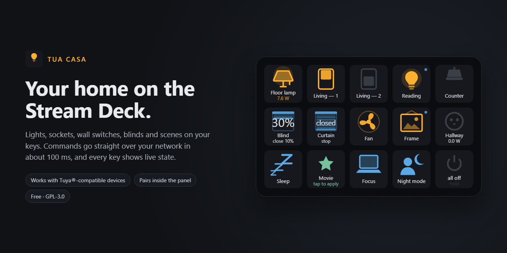
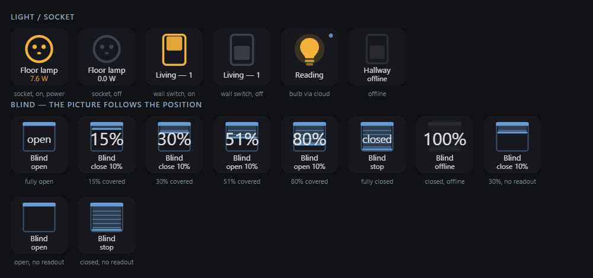
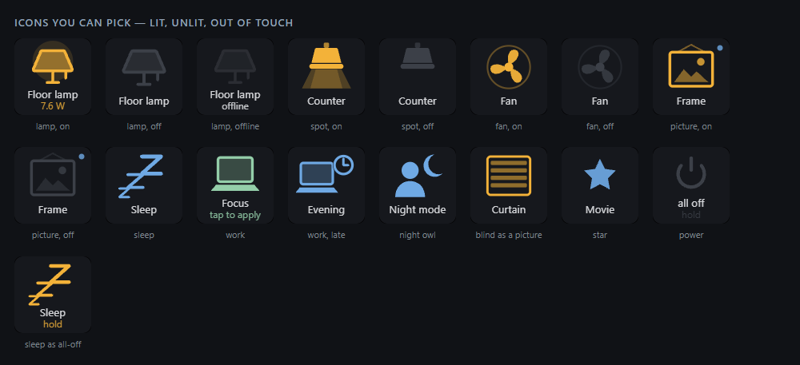
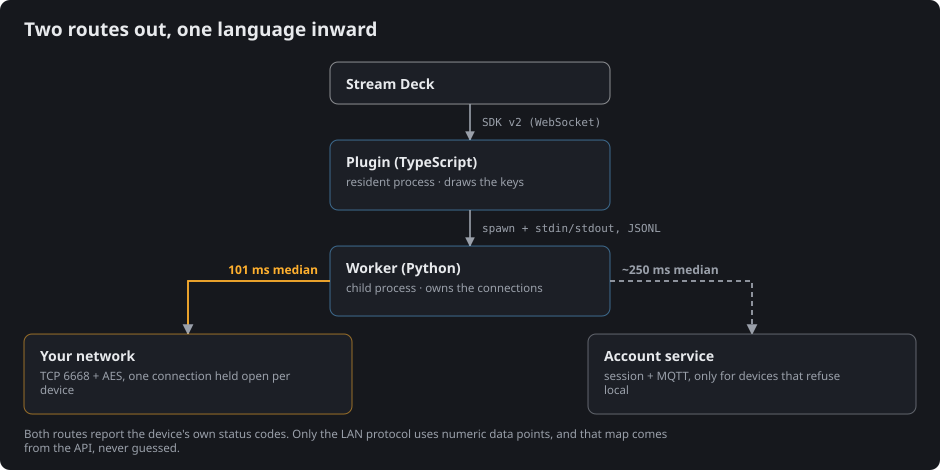

*Language: **English** · [Português](README.pt-BR.md)*

# Tua Casa — your smart home on the Stream Deck

[](LICENSE)


[](https://github.com/ffapd1989/tuacasa/releases/latest)



**Works with Tuya®-compatible devices** — the sockets, wall switches, bulbs and curtain
motors you already run from the **Smart Life®** or **Tuya Smart®** app. Tuya is the
platform behind hundreds of white-label brands, so if your device pairs with either app,
this plugin can drive it. Which ones work, which never will, and why:
[docs/TUYA.md](docs/TUYA.md). Not affiliated with either company — see
[Trademarks](#trademarks).

Turn Stream Deck keys into the light switches, blinds and scenes of your house. The keys
**show live state** — lit when the light is on, with the real power draw when the socket
measures it — and they update on their own when someone changes something from the phone.

Commands travel **directly over your network**, not through the internet: about **100 ms**
per press. Devices that refuse local connections fall back to the account session
automatically, and the key marks them with a small blue dot.

> **Pairing happens inside the Stream Deck.** Type the user code from your app, scan the QR
> that appears in the panel, and you are done. No terminal, no config file, no developer
> account. Step by step, with pictures: [docs/PAIRING.md](docs/PAIRING.md).



<sup>Contact sheet from `npm run keys`, drawn by the same functions that draw the physical
key. Nothing here is a mockup.</sup>

## What a key can do

| Action | What it does |
|---|---|
| **Light / socket** | Toggles one device. Shows on/off, offline, and watts when available |
| **Blind** | Open, close, stop, or nudge the position by a step you choose |
| **Scene** | Runs a scene you already built in your app, or records and replays one of your own |
| **All off** | Hold to switch off everything it can reach. A short tap does nothing, on purpose |

**One Deck key drives one wall key.** A 4-gang wall switch is one device, but it appears as
four independent entries — because that is how you actually lay it out on the Deck. You can
name each one.

**The label is yours.** Enter starts a new line and a long name wraps by itself; font, size,
weight and case are set per key, so the ones you reach for in the dark can shout. When the
label wants the whole key the icon steps aside, leaving its colour as a bar so the key still
says whether the light is on.

**So is the picture, and the colour.** Every key picks from the same gallery — bulb, table
lamp, ceiling spot, socket, wall switch, fan, blind, framed picture, star, Zzz, desk, late
desk, night, power — and any of nine accent colours. The picture still carries the state: the
spot only casts a beam when it is on, the switch flips, the blind hangs down as far as it
actually is.



## Requirements

- Windows 10/11 and Stream Deck software 6.5+
- Smart-home devices already working in your phone app
- The PC on the **same network** as the devices

Nothing else. The plugin carries its own Python inside, so there is nothing to install
first and nothing to type in a terminal.

## Install

1. Download `com.felipedrummond.tuacasa.streamDeckPlugin` from the
   [latest release](https://github.com/ffapd1989/tuacasa/releases/latest).
2. Double-click it. The Stream Deck app asks to install it; say yes.

Then drag any **Tua Casa** action onto a key and follow the panel: it asks for your **user
code** (in the app: *Me → ⚙ → Account and Security → User Code*), shows a QR code, and you scan
it with the same app. From there the panel lists everything it found.

## How it works



Holding the connection open is the whole trick. Measured on a real house:

| | median |
|---|---|
| new connection per command | 404 ms |
| **persistent connection** | **101 ms** |
| press and confirm, end to end | 206 ms |
| through the cloud fallback | ~250 ms |

Why the ecosystem works this way, what the account session actually buys, and which devices
can never go local: [docs/TUYA.md](docs/TUYA.md).

State is not polled. Each device pushes changes as they happen, so a lamp switched from the
phone repaints the key within seconds.

## Your data

Keys, tokens and the device inventory live in `%LOCALAPPDATA%\streamdeck-tuacasa\`, **outside
this repository**. Nothing is sent anywhere except to your own devices and, for the fallback
path, to the same service your phone app already talks to. There is no telemetry and no server
of ours — see [PRIVACY.md](PRIVACY.md).

## Naming the gangs of a switch

The API does **not** expose per-channel names, so they live in a file you can edit:

```
%LOCALAPPDATA%\streamdeck-tuacasa\channel-names.json
```

```json
{
  "bf1234....switch_1": "Ceiling",
  "# bf1234....switch_1": "Hallway switch — switch 1"
}
```

Keys starting with `#` are reference comments showing which gang is which. Without a name, the
list falls back to `Device — 1`, `Device — 2`. Restart the plugin after editing.

## Troubleshooting

Start with **Activity** at the bottom of the panel: it shows every press, every answer and
every failure as it happens, with no log file to open.

If you cloned the repository and have Python, there is also a probe that talks to the devices
without the plugin:

```powershell
python tools/probe.py list          # inventory and reachability
python tools/probe.py read "<name>" # raw state, with timing
python tools/probe.py scan          # who announces itself on the network
```

A device that answers `scan` but fails `read` almost always has a **stale local key** —
re-pair it in the app and press *Rescan network* in the panel. Error `914` means the key or
protocol version was rejected; `901`/`905` mean the packet never got there.

Plugin log: `%APPDATA%\Elgato\StreamDeck\Plugins\com.felipedrummond.tuacasa.sdPlugin\logs\`.

Known limits and what is not supported: [LIMITS.md](LIMITS.md).

## The rest of the documentation

| | |
|---|---|
| [docs/PAIRING.md](docs/PAIRING.md) | Connecting your account, step by step, with pictures |
| [docs/TUYA.md](docs/TUYA.md) | The Tuya / Smart Life ecosystem, and where this plugin sits in it |
| [LIMITS.md](LIMITS.md) | What does not work, and why |
| [PRIVACY.md](PRIVACY.md) | What is stored, and what leaves your machine |
| [THIRD-PARTY.md](THIRD-PARTY.md) | Every dependency, with version, licence and author |
| [CONTRIBUTING.md](CONTRIBUTING.md) | How to get it running, and the house rules |
| [SECURITY.md](SECURITY.md) | Reporting a vulnerability, and what is in scope |
| [docs/PUBLISHING.md](docs/PUBLISHING.md) | Why it ships on GitHub and not on the Elgato Marketplace, and what a store release would take |
| [docs/LAUNCH.md](docs/LAUNCH.md) | The launch kit: repository settings, release notes, announcement posts, demo shot list |

## Acknowledgements

This plugin stands on work by others, all under permissive licenses:

| Project | Author | License |
|---|---|---|
| [tinytuya](https://github.com/jasonacox/tinytuya) | Jason A. Cox | MIT |
| [tuya-device-sharing-sdk](https://github.com/tuya/tuya-device-sharing-sdk) | Tuya Inc. | MIT |
| [python-qrcode](https://github.com/lincolnloop/python-qrcode) | Lincoln Loop | BSD-3-Clause |
| [@elgato/streamdeck](https://github.com/elgatosf/streamdeck) | Elgato | MIT |

Every dependency, direct and transitive, with versions and the choice made on the two that
ship under a choice of licences: [THIRD-PARTY.md](THIRD-PARTY.md).

The QR pairing flow is the one the Home Assistant Tuya integration established. See
[LIMITS.md](LIMITS.md) for an honest note about the application identity it relies on.

## Trademarks

Tuya® and Smart Life® are trademarks of their respective owners. This project is **not
affiliated with, endorsed by, or sponsored by** them. The names are used only to state which
devices this plugin can talk to.

## License

**GPL-3.0-or-later** — see [LICENSE](LICENSE).

Use it, study it, change it, pass it on. What the licence adds is that anyone who receives
it, modified or not, must be able to get the complete source under these same terms: a fork
of this cannot be closed, and neither can a fork of that fork.

It requires freedom, not a price of zero — see
[docs/PUBLISHING.md](docs/PUBLISHING.md#the-licence-what-gpl-30-does-and-does-not-do) for
what that distinction means in practice.
