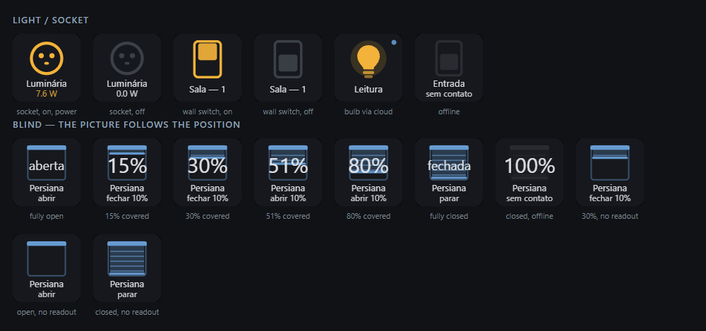
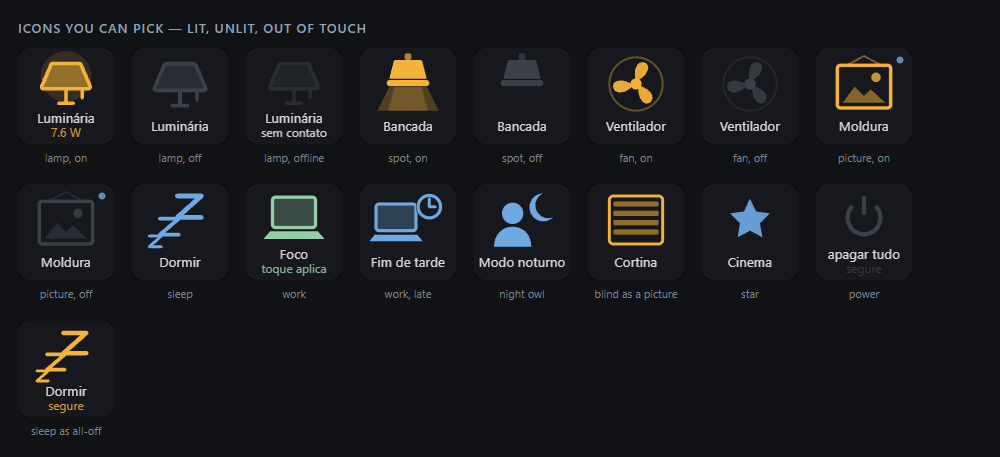
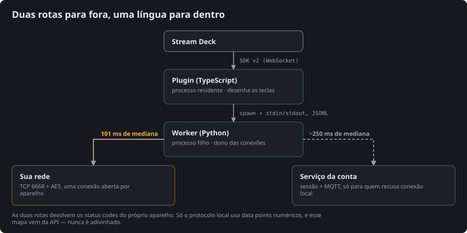

*Idioma: [English](README.md) · **Português***

# Tua Casa — a sua casa no Stream Deck

[](LICENSE)


**Funciona com aparelhos compatíveis com Tuya®** — as tomadas, interruptores de parede,
lâmpadas e motores de cortina que você já comanda pelo aplicativo **Smart Life®** ou
**Tuya Smart®**. A Tuya é a plataforma por trás de centenas de marcas white-label, então se
o seu aparelho pareia com qualquer um dos dois aplicativos, este plugin comanda ele. Quais
funcionam, quais nunca vão funcionar, e por quê:
[docs/TUYA.pt-BR.md](docs/TUYA.pt-BR.md). Sem afiliação com nenhuma das duas empresas —
veja [Marcas](#marcas).

Transforma teclas do Stream Deck nos interruptores, persianas e cenas da sua casa. As teclas
**mostram o estado ao vivo** — acesas quando a luz está acesa, com o consumo real quando a
tomada mede — e se atualizam sozinhas quando alguém mexe pelo celular.

Os comandos vão **direto pela sua rede**, sem passar pela internet: cerca de **100 ms** por
toque. Aparelhos que recusam conexão local caem automaticamente para a sessão da conta, e a
tecla os marca com um pontinho azul.

> **O pareamento acontece dentro do Stream Deck.** Você digita o código de usuário do seu app,
> escaneia o QR que aparece no painel, e pronto. Passo a passo, com imagens:
> [docs/PAIRING.pt-BR.md](docs/PAIRING.pt-BR.md). Sem terminal, sem arquivo de configuração, sem
> conta de desenvolvedor.



<sup>Folha de contato do `npm run keys`, desenhada pelas mesmas funções que desenham a tecla
física. As teclas falam o idioma da interface; as legendas em volta são técnicas e ficam em
inglês.</sup>

## O que uma tecla faz

| Ação | O que faz |
|---|---|
| **Luz / tomada** | Liga e desliga um dispositivo. Mostra aceso/apagado, sem contato, e watts quando houver |
| **Persiana** | Abre, fecha, para, ou move a posição por uma fração que você escolhe |
| **Cena** | Roda uma cena que você já criou no seu app, ou grava e reaplica uma sua |
| **Apagar tudo** | Segure para apagar tudo o que ele alcança. Um toque curto não faz nada, de propósito |

**Uma tecla do Deck comanda uma tecla da parede.** Um interruptor de 4 teclas é um aparelho só,
mas aparece como quatro entradas independentes — porque é assim que você realmente monta no
Deck. Cada uma pode ser nomeada.

**O rótulo é seu.** Enter quebra a linha e nome comprido quebra sozinho; fonte, tamanho,
negrito e caixa são por tecla, então as que você procura no escuro podem gritar. Quando o
rótulo quer a tecla inteira, o ícone sai de cena e deixa a cor dele numa barra — a tecla
continua dizendo se a luz está acesa.

**O desenho e a cor também.** Toda tecla escolhe da mesma galeria — lâmpada, abajur, spot de
teto, tomada, interruptor, ventoinha, persiana, quadro, estrela, ZzZ, escrivaninha, serão,
noite, liga-desliga — e entre nove cores de acento. O desenho continua carregando o estado: o
spot só joga facho quando está aceso, o interruptor vira, a persiana desce até onde ela
realmente está.



## Requisitos

- Windows 10/11 e Stream Deck 6.5+
- **Python 3.10+** no PATH (o plugin roda um worker local pequeno)
- Aparelhos já funcionando no app do celular
- O PC na **mesma rede** dos aparelhos

```powershell
pip install -r requirements.txt
```

## Instalar

```powershell
cd streamdeck-plugin
npm install
npm run build
streamdeck link "com.felipedrummond.tuacasa.sdPlugin"
streamdeck restart com.felipedrummond.tuacasa
```

Depois arraste qualquer ação **Tua Casa** para uma tecla e siga o painel: ele pede o seu
**código de usuário** (no app: *Eu → ⚙ → Conta e segurança → Código de usuário*), mostra um QR,
e você escaneia com o mesmo app. A partir daí o painel lista tudo o que encontrou.

## Como funciona



Segurar a conexão aberta é o truque inteiro. Medido numa casa real:

| | mediana |
|---|---|
| conexão nova a cada comando | 404 ms |
| **conexão persistente** | **101 ms** |
| tocar e confirmar, ponta a ponta | 206 ms |
| pela nuvem de reserva | ~250 ms |

Por que o ecossistema funciona assim, o que a sessão da conta realmente compra e quais
aparelhos nunca vão para a rota local: [docs/TUYA.pt-BR.md](docs/TUYA.pt-BR.md).

O estado não é consultado em laço. Cada aparelho empurra a mudança quando ela acontece, então
uma lâmpada acesa pelo celular repinta a tecla em segundos.

## Os seus dados

Chaves, tokens e o inventário ficam em `%LOCALAPPDATA%\streamdeck-tuacasa\`, **fora deste
repositório**. Nada é enviado a lugar nenhum além dos seus próprios aparelhos e, no caminho de
reserva, ao mesmo serviço com que o app do seu celular já conversa. Não há telemetria nem
servidor nosso — veja [PRIVACY.pt-BR.md](PRIVACY.pt-BR.md).

## Nomear as teclas de um interruptor

A API **não** fornece o nome de cada canal, então eles ficam num arquivo que você edita:

```
%LOCALAPPDATA%\streamdeck-tuacasa\channel-names.json
```

```json
{
  "bf1234....switch_1": "Teto",
  "# bf1234....switch_1": "Interruptor do corredor — tecla 1"
}
```

Chaves começando com `#` são comentários de referência, para você saber qual é qual. Sem nome,
a lista cai em `Aparelho — 1`, `Aparelho — 2`. Reinicie o plugin depois de editar.

## Quando algo não responde

```powershell
python tools/probe.py list          # inventário e alcance
python tools/probe.py read "<nome>" # estado cru, com tempo
python tools/probe.py scan          # quem se anuncia na rede
```

Aparelho que responde ao `scan` mas falha no `read` quase sempre está com a **chave local
vencida** — repareie no app e aperte *Reescanear rede* no painel. Erro `914` significa que a
chave ou a versão de protocolo foi rejeitada; `901`/`905` significam que o pacote não chegou.

Log do plugin: `com.felipedrummond.tuacasa.sdPlugin/logs/`.

Limitações conhecidas: [LIMITS.pt-BR.md](LIMITS.pt-BR.md).

## O resto da documentação

| | |
|---|---|
| [docs/PAIRING.pt-BR.md](docs/PAIRING.pt-BR.md) | Conectar a sua conta, passo a passo, com imagens |
| [docs/TUYA.pt-BR.md](docs/TUYA.pt-BR.md) | O ecossistema Tuya / Smart Life, e onde este plugin se encaixa |
| [LIMITS.pt-BR.md](LIMITS.pt-BR.md) | O que não funciona, e por quê |
| [PRIVACY.pt-BR.md](PRIVACY.pt-BR.md) | O que é guardado, e o que sai da sua máquina |
| [THIRD-PARTY.pt-BR.md](THIRD-PARTY.pt-BR.md) | Toda dependência, com versão, licença e autoria |
| [CONTRIBUTING.pt-BR.md](CONTRIBUTING.pt-BR.md) | Como colocar para rodar, e as regras da casa |
| [SECURITY.pt-BR.md](SECURITY.pt-BR.md) | Como relatar uma vulnerabilidade, e o que está no escopo |
| [docs/PUBLISHING.pt-BR.md](docs/PUBLISHING.pt-BR.md) | O que ainda separa isto de uma publicação na loja |

## Créditos

Este plugin se apoia em trabalho de outras pessoas, tudo sob licença permissiva:

| Projeto | Autoria | Licença |
|---|---|---|
| [tinytuya](https://github.com/jasonacox/tinytuya) | Jason A. Cox | MIT |
| [tuya-device-sharing-sdk](https://github.com/tuya/tuya-device-sharing-sdk) | Tuya Inc. | MIT |
| [python-qrcode](https://github.com/lincolnloop/python-qrcode) | Lincoln Loop | BSD-3-Clause |
| [@elgato/streamdeck](https://github.com/elgatosf/streamdeck) | Elgato | MIT |

Toda dependência, direta e transitiva, com versões e a escolha feita nas duas que vêm com
licença dupla: [THIRD-PARTY.pt-BR.md](THIRD-PARTY.pt-BR.md).

O fluxo de pareamento por QR é o que a integração Tuya do Home Assistant estabeleceu. Veja
[LIMITS.pt-BR.md](LIMITS.pt-BR.md) para uma nota honesta sobre a identidade de aplicação de que
ele depende.

## Marcas

Tuya® e Smart Life® são marcas de seus respectivos donos. Este projeto **não é afiliado,
endossado nem patrocinado** por eles. Os nomes aparecem apenas para dizer com quais aparelhos
este plugin conversa.

## Licença

**GPL-3.0-or-later** — veja [LICENSE](LICENSE).

Use, estude, modifique, repasse. O que a licença acrescenta é que quem receber, modificado
ou não, tem de poder obter o código-fonte completo sob estes mesmos termos: um fork disto
não pode ser fechado, e um fork daquele fork também não.

Ela obriga a liberdade, não o preço zero — veja
[docs/PUBLISHING.pt-BR.md](docs/PUBLISHING.pt-BR.md#a-licença-o-que-a-gpl-30-faz-e-o-que-ela-não-faz)
para o que essa distinção significa na prática.
