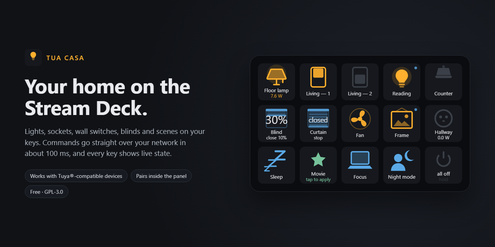

*Language: **English** · [Português](LAUNCH.pt-BR.md)*

# Launch kit

Everything that goes on GitHub and out into the world for a release, ready to paste: the
repository's shop window, the release, and the posts that point people at it. The Elgato
Marketplace listing has its own file, [marketplace/LISTING.md](marketplace/LISTING.md).

The pictures are generated, not hand-made: `npm run promo` (in `streamdeck-plugin/`)
redraws them from the same functions that draw the physical key. If the keys change, run it
again.

## Repository settings

| Field | Value |
|---|---|
| Visibility | Public |
| Description | see below |
| Website | `https://github.com/ffapd1989/tuacasa/releases/latest` |
| Topics | `stream-deck` `streamdeck-plugin` `elgato` `tuya` `smart-life` `smart-home` `home-automation` `local-control` `windows` |
| Social preview | [img/social-preview-en.png](img/social-preview-en.png) — 1280×640 |
| Issues | on |
| Private vulnerability reporting | on — [SECURITY.md](../SECURITY.md) sends people to that button, and it does not exist until this is enabled |

Description, 242 of the 350 characters GitHub allows:

```text
Stream Deck plugin for Tuya®-compatible smart-home devices (Smart Life®, Tuya Smart®): lights, sockets, wall switches, blinds and scenes, driven over your own network in about 100 ms, with live state on every key. Windows · pt/en/es · GPL-3.0
```

The social preview can only be uploaded by hand: *Settings → General → Social preview →
Edit*. Everything else in the table can be set from a terminal:

```powershell
gh repo edit ffapd1989/tuacasa --visibility public --accept-visibility-change-consequences `
  --homepage "https://github.com/ffapd1989/tuacasa/releases/latest" `
  --add-topic stream-deck,streamdeck-plugin,elgato,tuya,smart-life,smart-home,home-automation,local-control,windows
gh api -X PUT repos/ffapd1989/tuacasa/private-vulnerability-reporting
```

## The release

| Field | Value |
|---|---|
| Tag | `v1.0.1` |
| Title | `Tua Casa 1.0.1` |
| Asset | `dist/com.felipedrummond.tuacasa.streamDeckPlugin`, built by `npm run pack` from the tagged commit |

The version in the tag must match `Version` in the manifest (`1.0.1.0` — the Stream Deck
wants four digits). Each release's notes open with what changed since the one before, then
repeat the install steps and the feature list for whoever arrives for the first time.

Release notes:

```markdown


**New in 1.0.1:** the plugin icon now carries the name, "Tua Casa", so it is easy to spot in the Stream Deck app. Nothing else changes: installing it over 1.0.0 keeps your keys and your paired account.

## Install

1. Download **`com.felipedrummond.tuacasa.streamDeckPlugin`** below.
2. Double-click it, and let the Stream Deck app install it.
3. Drag a Tua Casa action onto a key. The panel asks for the user code from your Smart Life or Tuya Smart app and shows a QR code: scan it with the same app, and your devices appear in the list.

Python comes inside the package, so there is nothing else to install and no terminal to open.

## What it does

- **Light / socket**: on and off, with live state and the watts where the device measures them. Each gang of a wall switch gets its own key.
- **Blind**: open, close, stop, or move by a step. The key draws where the blind really is.
- **Scene**: run a scene from your app, or record what is on right now and replay it with a tap.
- **All off**: hold it to switch off everything it can reach.
- Commands go straight over your own network, in about 100 ms. Devices that refuse local connections fall back to the cloud on their own.

**Requirements:** Windows 10 or 11, Stream Deck 7.1 or later, devices already working in the Smart Life or Tuya Smart app, and the PC on the same network as them. What does not work, and why: [LIMITS.md](https://github.com/ffapd1989/tuacasa/blob/main/LIMITS.md).

---

Tuya®, Smart Life® and Tuya Smart® are registered trademarks of their respective owners; Tua Casa is not affiliated with them. Free and open source, GPL-3.0-or-later.
```

```powershell
gh release create v1.0.1 dist/com.felipedrummond.tuacasa.streamDeckPlugin `
  --title "Tua Casa 1.0.1" --notes-file <file with the notes above>
```

## Announcement posts

Read each community's self-promotion rules before posting; some want a flair, some a ratio
of other activity. Attach the social preview, or better, the demo video below.

**Reddit — r/StreamDeck**

```text
Title: I made a free, open-source plugin to control Tuya / Smart Life devices from the Stream Deck — locally, about 100 ms per press, with live state on the keys

Body:
My house runs on cheap Tuya-based switches, sockets and blind motors, and I wanted them on my Stream Deck without opening the phone. So I built Tua Casa.

- One key per wall key: a 4-gang switch becomes four keys
- Keys show live state (lit when the light is on, watts when the socket measures) and update when someone uses the phone
- Commands go over your own network, about 100 ms; devices that refuse local control fall back to the cloud automatically
- Blinds, scenes from your app or recorded on the Deck, and a hold-to-fire "all off"
- Pairing happens inside the Stream Deck panel: type your app's user code, scan a QR. No terminal, no developer account

Windows only. Free, GPL-3.0. Download (one file, double-click): https://github.com/ffapd1989/tuacasa/releases/latest

Honest limits are in LIMITS.md, including the one about the login identity it shares with Home Assistant's Tuya integration.
```

**Reddit — r/homeautomation or r/smarthome**

```text
Title: Local control of Tuya / Smart Life devices from an Elgato Stream Deck (open source)

Body:
Tua Casa is a Stream Deck plugin that keeps a persistent local connection to each Tuya device, so a press takes about 100 ms instead of a round trip through the cloud (404 ms median with a new connection per command, 101 ms with the connection held open, measured on a real house). Devices push their own state changes, so the keys stay in sync with the phone. Anything that refuses local control falls back to the account session.

Pairing uses the same user-code + QR flow as Home Assistant's Tuya integration, done entirely inside the Stream Deck panel.

https://github.com/ffapd1989/tuacasa — GPL-3.0, Windows.
```

**LinkedIn, in Portuguese** — in [LAUNCH.pt-BR.md](LAUNCH.pt-BR.md#posts-de-divulgação).

## Demo video

It is what makes a post land, and the Marketplace listing uses the same footage
([marketplace/LISTING.md](marketplace/LISTING.md#demo-video)). A real key driving a real
device is the one thing the generated pictures cannot show.

- 30 to 60 seconds, MP4, 1920×1080, or a GIF under 10 MB for the README
- Film the Deck and the room in the same shot, so a press and a lamp lighting up are one
  event on screen

Shots, in order:

1. A tap on a **Light** key: the lamp in the room turns on and the key lights up.
2. The same lamp switched off **from the phone**: the key goes dark on its own, seconds
   later.
3. A **Blind** key nudged twice: the blind moves, and the drawing on the key follows it.
4. **All off** held down: everything goes dark.
5. The panel, briefly: the device list and the icon gallery.

What a recording must not show: the user code, the QR, device IDs or local keys from the
Activity log, and anything on screen that says where the house is.

## Before announcing

- [ ] Every commit for the release pushed to `main`
- [ ] Repository public, description, website and topics set, private vulnerability
      reporting on (the commands above)
- [ ] Social preview uploaded by hand
- [ ] `npm run pack` on the tagged commit, and the release created with that file
- [ ] Installed from the release on a machine that is not the author's, with no Python
      and no Node, following only the README: download, double-click, pair, press a key.
      This is the check that catches a step that works only because the author's machine
      already had something
- [ ] The README's download badge resolves (it reads the latest release, so it only works
      once the repository is public)
