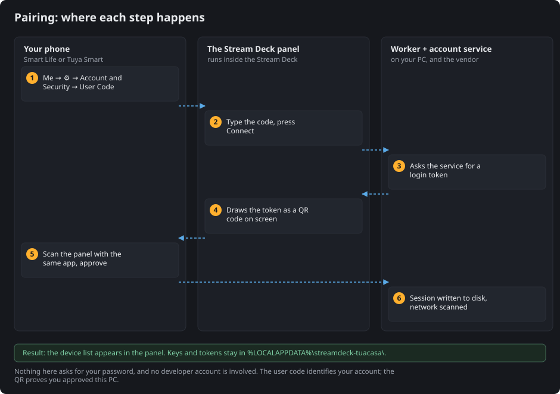
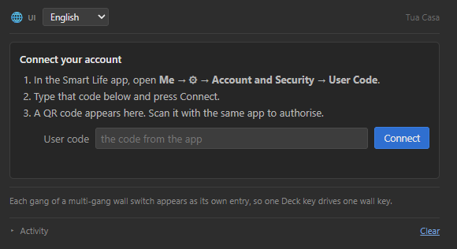
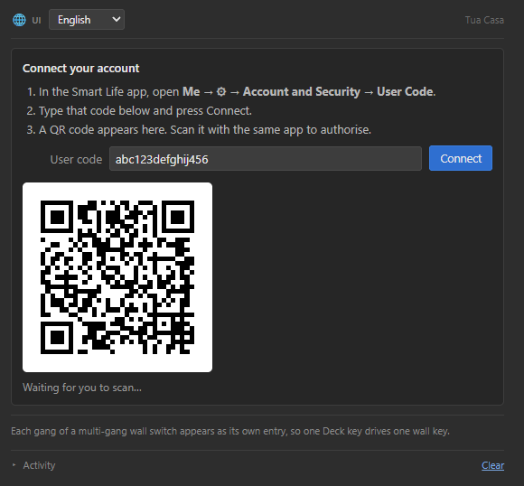
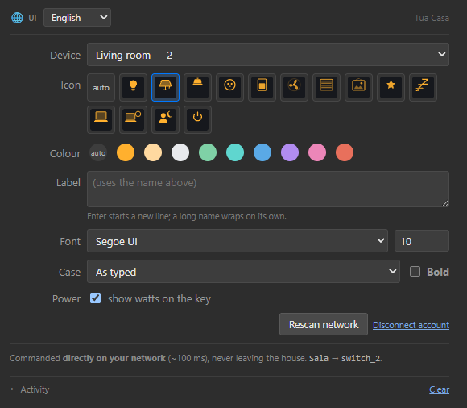
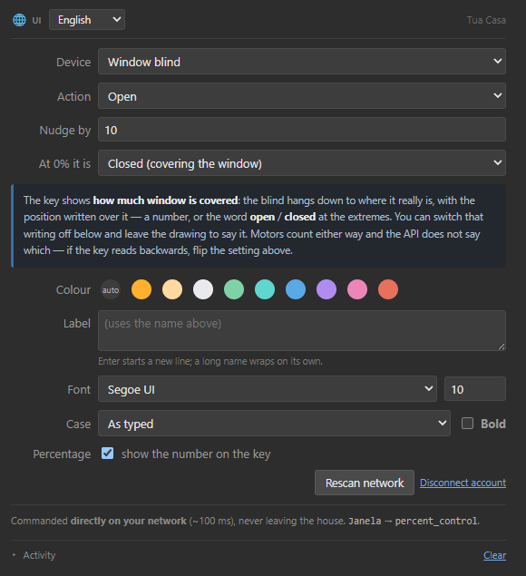
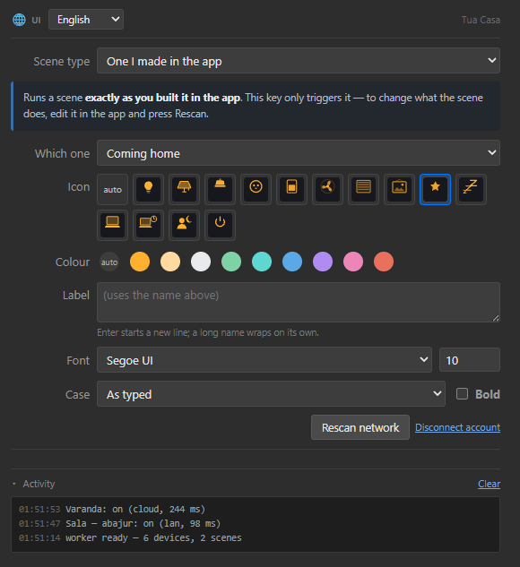

*Language: **English** · [Português](PAIRING.pt-BR.md)*

# Connecting your account

Everything on this page happens in two places: the app already on your phone, and the
Tua Casa panel inside the Stream Deck software. There is no terminal, no config file, and
no developer account.

It takes about a minute. If you already know what a *user code* is, skip to
[step 2](#step-2--type-it-into-the-panel).

## What you need first

- The **Smart Life** or **Tuya Smart** app, with your devices already working in it.
  Either app works — they are the same service under two names.
- The PC and the devices on the **same network**.
- Python 3.10+ on the PATH, and the plugin installed. See the
  [README](../README.md#install).

> **Why a code and not a password?** Tua Casa never sees your password. The user code
> only *names* your account; the QR code is what proves you sat at this PC and approved
> it. See [What this actually authorises](#what-this-actually-authorises) at the bottom,
> and [docs/TUYA.md](TUYA.md) for why the ecosystem works this way.

## Step 1 — find your user code in the app

On your phone, in Smart Life or Tuya Smart:

| | Tap |
|---|---|
| 1 | **Me** — the last tab, bottom right |
| 2 | the **⚙ gear**, top right |
| 3 | **Account and Security** |
| 4 | scroll to the bottom: **User Code** |

It is a short string of letters and digits, something like `abc123defghij456`. It is not
secret in the password sense — it identifies your account, and on its own it cannot log
anyone in. But there is no reason to publish it either.

> The labels above are the English app. In other languages the path is the same shape and
> the same position on screen: *account* → *security* → the last row. Wording varies
> between app versions.

## Step 2 — type it into the panel

Drag any **Tua Casa** action onto a Stream Deck key. The panel on the right asks for the
code:

Type it in and press **Connect**.

The language selector at the top left is the panel's own: **pt · en · es**, or *Follow
Stream Deck* to take whatever the Stream Deck software is set to.

## Step 3 — scan the QR code that appears

A moment later the panel draws a QR code:

Back on the phone, in the same app:

| | Tap |
|---|---|
| 1 | the **+** in the top right of the home screen |
| 2 | **Scan** — the QR scanner |
| 3 | point the camera at your monitor |
| 4 | **Confirm login** |

The panel is watching. It checks every two seconds for up to five minutes, and switches
to **Connected** the moment you approve. Then it scans your network — that takes a few
seconds more, because it waits for devices to announce themselves.

If the code times out, press **Connect** again for a fresh one.

## Step 4 — pick what the key does

Once connected, the panel lists everything it found:

**Device** groups by the raw category the service reports (`kg` wall switch, `cz` socket,
`dj` light, `cl` curtain motor) and the manufacturer's own product name. Nothing there is
guessed from what you called the device.

Each gang of a multi-gang wall switch is its own entry — `Living room — 1`,
`Living room — 2` — because one Deck key should drive one wall key. To give the gangs
real names, see [Naming the gangs](../README.md#naming-the-gangs-of-a-switch).

A device marked **☁** answers through the account service instead of your network. It
still works; it is just slower, and the key marks it with a small blue dot.

The other three actions configure the same way:

| Action | Extra choices |
|---|---|
| **Blind** | open / close / stop / nudge, the step size, and which end 0% means |
| **Scene** | a scene you built in the app, or one recorded here from what is on right now |
| **All off** | nothing to choose — hold the key to fire it |

The **Activity** section at the bottom is the worker's recent log — timings, and which
route each command took. It is the first place to look when a key does not respond.

## What this actually authorises

Approving the QR gives this PC a **session on your account**, the same kind your phone
holds. With it, the worker reads your device list, the local keys those devices expect,
and the capabilities each one exposes; runs your scenes; and commands devices that refuse
local connections.

What lands on disk, in `%LOCALAPPDATA%\streamdeck-tuacasa\`:

| File | What it holds |
|---|---|
| `tokens.json` | the session, and your user code |
| `devices.json` | names, addresses, **local keys**, capabilities |
| `channel-names.json` | names you gave to each gang |
| `scenes.json` | scenes recorded here |

**Treat that folder like a password file.** Anyone who copies it can control your
devices. It lives outside the project folder precisely so it can never be committed by
accident — see [PRIVACY.md](../PRIVACY.md).

To revoke: press **Disconnect account** in the panel, which deletes the session, or
delete the folder. You can also remove the authorisation from the app's own device list.

## When it goes wrong

**"user code refused"** — the code was mistyped, or it came from a different account than
the one you scan with. Both have to be the same account.

**The QR expires before you scan it.** Five minutes is the limit. Press **Connect**
again.

**Connected, but the list is empty.** The account has no devices, or none of them
finished the network scan. Press **Rescan network**.

**A device is in the list but the key never responds.** Almost always a stale local key —
re-pair that device in the app, then press **Rescan network**. Error `914` means the key
was rejected; `901` and `905` mean the packet never arrived.
[LIMITS.md](../LIMITS.md) has the full list.

**Two workers at once burn each other's session.** The refresh token is single use. Run
one Stream Deck, and note that `tools/probe.py` deliberately never touches the cloud
session for exactly this reason.
