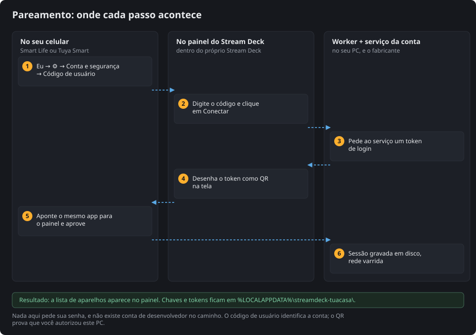
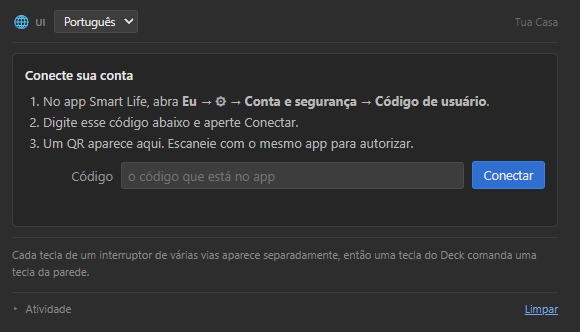
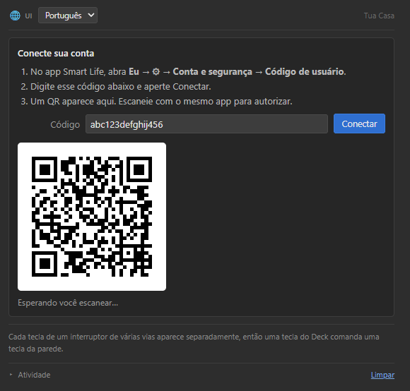
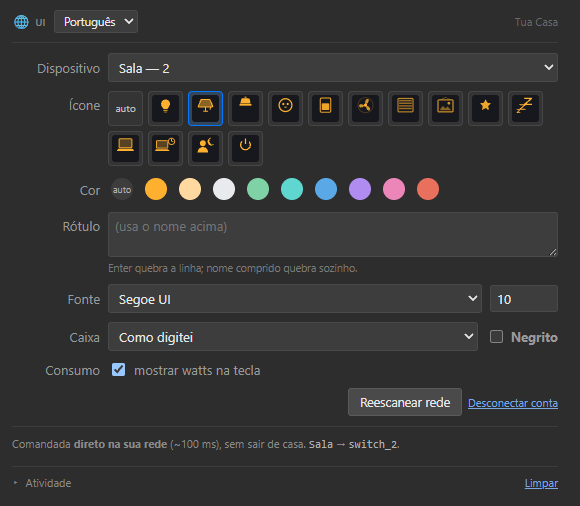
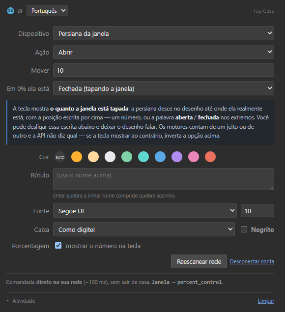
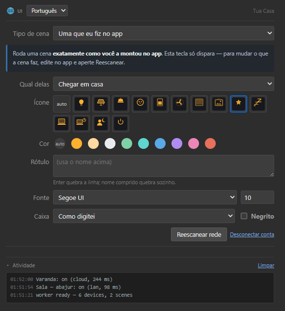

*Idioma: [English](PAIRING.md) · **Português***

# Conectando a sua conta

Tudo nesta página acontece em dois lugares: o aplicativo que já está no seu celular e o
painel do Tua Casa dentro do programa do Stream Deck. Não há terminal, não há arquivo de
configuração e não há conta de desenvolvedor.

Leva cerca de um minuto. Se você já sabe o que é um *código de usuário*, pule para o
[passo 2](#passo-2--digite-no-painel).

## O que você precisa antes

- O aplicativo **Smart Life** ou **Tuya Smart**, com os aparelhos já funcionando nele.
  Qualquer um dos dois serve — são o mesmo serviço com dois nomes.
- O PC e os aparelhos na **mesma rede**.
- Python 3.10+ no PATH e o plugin instalado. Veja o
  [LEIA-ME](../README.pt-BR.md#instalar).

> **Por que um código e não a senha?** O Tua Casa nunca vê a sua senha. O código de
> usuário apenas *nomeia* a sua conta; o QR é o que prova que você estava neste PC e
> autorizou. Veja [O que isso realmente autoriza](#o-que-isso-realmente-autoriza) no fim,
> e [docs/TUYA.pt-BR.md](TUYA.pt-BR.md) para entender por que o ecossistema funciona
> assim.

## Passo 1 — encontre o código de usuário no aplicativo

No celular, no Smart Life ou no Tuya Smart:

| | Toque em |
|---|---|
| 1 | **Eu** — a última aba, no canto inferior direito |
| 2 | a **⚙ engrenagem**, no canto superior direito |
| 3 | **Conta e segurança** |
| 4 | role até o fim: **Código de usuário** |

É uma sequência curta de letras e números, algo como `abc123defghij456`. Não é secreto no
sentido de uma senha — ele identifica a sua conta e, sozinho, não autentica ninguém. Mas
também não há motivo para publicá-lo.

> Os rótulos acima são os do aplicativo em português. Em outros idiomas o caminho tem o
> mesmo formato e a mesma posição na tela: *conta* → *segurança* → a última linha. As
> palavras mudam entre versões do aplicativo.

## Passo 2 — digite no painel

Arraste qualquer ação do **Tua Casa** para uma tecla do Stream Deck. O painel à direita
pede o código:

Digite e clique em **Conectar**.

O seletor de idioma no canto superior esquerdo é do próprio painel: **pt · en · es**, ou
*Seguir o Stream Deck* para acompanhar o idioma do programa da Elgato.

## Passo 3 — leia o QR code que aparece

Um instante depois o painel desenha um QR code:

De volta ao celular, no mesmo aplicativo:

| | Toque em |
|---|---|
| 1 | o **+** no canto superior direito da tela inicial |
| 2 | **Ler código** — o leitor de QR |
| 3 | aponte a câmera para o monitor |
| 4 | **Confirmar login** |

O painel fica observando. Ele verifica a cada dois segundos por até cinco minutos e passa
para **Conectado** no instante em que você autoriza. Depois varre a sua rede — isso leva
alguns segundos a mais, porque ele espera os aparelhos se anunciarem.

Se o código expirar, clique em **Conectar** de novo para gerar outro.

## Passo 4 — escolha o que a tecla faz

Conectado, o painel lista tudo o que encontrou:

**Aparelho** agrupa pela categoria bruta que o serviço informa (`kg` interruptor de
parede, `cz` tomada, `dj` lâmpada, `cl` motor de cortina) e pelo nome comercial do
fabricante. Nada ali é deduzido do nome que você deu ao aparelho.

Cada tecla de um interruptor de várias teclas é uma entrada própria — `Sala — 1`,
`Sala — 2` — porque uma tecla do Deck deve comandar uma tecla da parede. Para dar nomes
de verdade a cada uma, veja
[Nomeando as teclas de um interruptor](../README.pt-BR.md#nomear-as-teclas-de-um-interruptor).

Um aparelho marcado com **☁** responde pelo serviço da conta em vez de pela sua rede.
Continua funcionando; só é mais lento, e a tecla o marca com um pontinho azul.

As outras três ações se configuram do mesmo jeito:

| Ação | Escolhas a mais |
|---|---|
| **Persiana** | abrir / fechar / parar / ajustar, o tamanho do passo e qual extremo é o 0% |
| **Cena** | uma cena feita no aplicativo, ou uma gravada aqui a partir do que está aceso agora |
| **Apagar tudo** | nada a escolher — segure a tecla para disparar |

A seção **Atividade**, no rodapé, é o registro recente do worker — tempos e por qual rota
cada comando saiu. É o primeiro lugar para olhar quando uma tecla não responde.

## O que isso realmente autoriza

Aprovar o QR dá a este PC uma **sessão na sua conta**, do mesmo tipo que o seu celular
mantém. Com ela, o worker lê a lista de aparelhos, as chaves locais que esses aparelhos
esperam e o que cada um sabe fazer; executa as suas cenas; e comanda os aparelhos que
recusam conexão local.

O que fica gravado em disco, em `%LOCALAPPDATA%\streamdeck-tuacasa\`:

| Arquivo | O que guarda |
|---|---|
| `tokens.json` | a sessão e o seu código de usuário |
| `devices.json` | nomes, endereços, **chaves locais**, capacidades |
| `channel-names.json` | os nomes que você deu a cada tecla do interruptor |
| `scenes.json` | as cenas gravadas aqui |

**Trate essa pasta como um arquivo de senhas.** Quem a copiar controla os seus aparelhos.
Ela mora fora da pasta do projeto justamente para nunca ser commitada por acidente — veja
[PRIVACY.pt-BR.md](../PRIVACY.pt-BR.md).

Para revogar: clique em **Desconectar conta** no painel, que apaga a sessão, ou apague a
pasta. Você também pode remover a autorização pela própria lista de dispositivos do
aplicativo.

## Quando dá errado

**"user code refused"** — o código foi digitado errado, ou veio de uma conta diferente
daquela com que você leu o QR. As duas têm de ser a mesma conta.

**O QR expira antes da leitura.** O limite é de cinco minutos. Clique em **Conectar** de
novo.

**Conectou, mas a lista está vazia.** A conta não tem aparelhos, ou nenhum deles concluiu
a varredura da rede. Clique em **Varrer a rede**.

**O aparelho aparece na lista, mas a tecla nunca responde.** Quase sempre é chave local
vencida — refaça o pareamento daquele aparelho no aplicativo e clique em **Varrer a
rede**. O erro `914` significa que a chave foi rejeitada; `901` e `905` significam que o
pacote nunca chegou. [LIMITS.pt-BR.md](../LIMITS.pt-BR.md) tem a lista completa.

**As teclas da nuvem mostram *reconectar* sob um sinal de alerta.** A sessão da conta
expirou, o que acontece quando o computador fica desligado por um dia ou mais. Abra o painel
de qualquer tecla Tua Casa: o cartão de pareamento volta ao topo. Digite o código de usuário e
escaneie o QR; nada do que está configurado se perde. Não use **Desconectar conta** para isso
— ele apaga também o inventário, e nenhuma tecla funciona até o QR ser lido. Por que ela
vence: [LIMITS.pt-BR.md](../LIMITS.pt-BR.md).

**Dois workers ao mesmo tempo queimam a sessão um do outro.** O refresh token é de uso
único. Rode um Stream Deck só, e note que o `tools/probe.py` deliberadamente nunca toca na
sessão da nuvem exatamente por isso.
