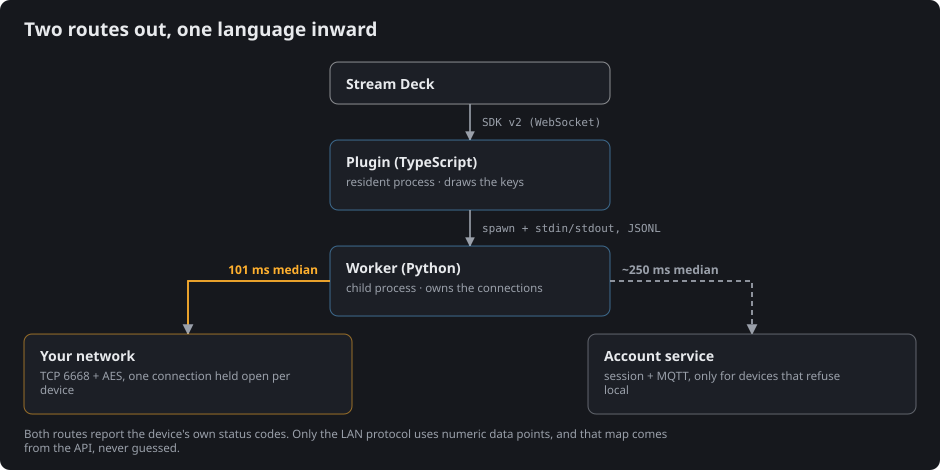

*Language: **English** · [Português](TUYA.pt-BR.md)*

# The Tuya / Smart Life world, and where this plugin sits in it

Useful if you are deciding whether this plugin can talk to your hardware, or wondering why
smart-home tooling in this ecosystem always asks for something odd.

## One platform, a thousand brand names

Tuya is not a brand you buy — it is the platform other brands buy. A manufacturer takes
Tuya's module, firmware and cloud, prints its own logo on the box, and ships a rebadged
app. The socket, the wall switch and the curtain motor may carry three different names and
still be the same device inside.

Two generic apps drive all of it: **Smart Life** and **Tuya Smart**. Same service, two
front doors. If your device pairs with either, this plugin can see it.

A rebadged vendor app usually works too — the account is the same — but the menu paths in
[PAIRING.md](PAIRING.md) are written for the two generic apps.

## Two ways a program can reach those devices

**The developer route.** Register on the Tuya IoT Platform, create a cloud project, link
your app account to it, and receive an Access ID and Access Secret. That is how the older
generation of integrations worked. It puts a developer account, a project console and a
subscription between you and your own lightbulb.

**The QR route.** Your app account authorises one specific program on one specific
machine, by showing it a QR code. No developer account, no console, no project. This is
what Tua Casa does, and it is the flow the Home Assistant Tuya integration established —
see [Acknowledgements](#acknowledgements).

The QR route needs one thing the developer route does not: an **application identity**,
a `client_id` and `schema` registered with the vendor, which says *which program* is
asking. That is the origin of the one blocking issue in
[LIMITS.md](../LIMITS.md#blocking-issue-for-a-store-release) — read it before deciding
what to do with this project.

## What the session buys you

Approving the QR gives the worker a session on your account. Three things come out of it
that no amount of network sniffing would give you:

| | Why it matters |
|---|---|
| **Device inventory** | ids, names, categories, online state, and whether the device allows local control at all |
| **Local keys** | the per-device AES key the device demands before it will accept a command |
| **Capability map** | which status codes each device exposes, and how they map to numeric data points |

The **local key** is the interesting one. A Tuya device on your network will not obey a
stranger: it wants a key that only the account knows. That is why a purely offline tool
cannot exist here — something has to fetch the keys once, and the account is the only
thing that has them.

Keys are refreshed by *Rescan network*, and re-pairing a device in the app invalidates its
key ([LIMITS.md](../LIMITS.md)).

## Then it goes local

With the keys in hand, the worker stops needing the internet for commands.

Devices announce themselves on the network by UDP broadcast, and that announcement carries
the address and the protocol version the device speaks
([`worker/tuacasa.py:158`](../streamdeck-plugin/com.felipedrummond.tuacasa.sdPlugin/worker/tuacasa.py#L158)).
The worker crosses that with the account's inventory
([`worker/tuacasa.py:474`](../streamdeck-plugin/com.felipedrummond.tuacasa.sdPlugin/worker/tuacasa.py#L474)):
the network says *where*, the account says *what* and *with which key*. Commands then go
straight over TCP 6668, AES-encrypted, on a connection held open per device.

Two vocabularies meet here, and the difference is worth knowing:

- **Status codes** — `switch_1`, `switch_led`, `percent_control`. Readable, stable, what
  the API speaks.
- **Data points (dps)** — `1`, `2`, `3`. What the local protocol speaks, and their meaning
  differs per product.

Tua Casa speaks status codes everywhere and converts to data points only at the wire,
using the `local_strategy` map the API itself hands over — never a guess
([`worker/tuacasa.py:10`](../streamdeck-plugin/com.felipedrummond.tuacasa.sdPlugin/worker/tuacasa.py#L10)).
Guessing that mapping is the single most common way a Tuya tool ends up turning on the
wrong thing.

## What will not work, whatever you do

Some limits belong to the platform, not to this plugin:

- Devices that **declare no local support** — locks, some IR bridges. The vendor forbids
  it in firmware.
- **Sub-devices behind a gateway** (Zigbee, Bluetooth). They have no address of their own;
  everything reaches them through the hub, over the account.
- Devices that **announce an address that does not answer**. A network topology problem,
  usually a mesh node that bridges broadcast but not unicast.

All three fall back to the account route when the device is online. The full list, with
the error codes that tell them apart, is in [LIMITS.md](../LIMITS.md).

## Neighbours worth knowing

If Tua Casa is not what you need, these solve nearby problems and are all open source:

| Project | What it is for |
|---|---|
| [tinytuya](https://github.com/jasonacox/tinytuya) | Python library for the local protocol — the layer Tua Casa's LAN route is built on |
| [tuya-device-sharing-sdk](https://github.com/tuya/tuya-device-sharing-sdk) | The vendor's own SDK for the QR session, published by Tuya |
| [Home Assistant Tuya integration](https://www.home-assistant.io/integrations/tuya/) | Whole-house automation, where the QR flow used here comes from |

## Acknowledgements

The QR pairing flow is the one the Home Assistant project established, and it runs on
Tuya's own device-sharing SDK. Full dependency and licence inventory:
[THIRD-PARTY.md](../THIRD-PARTY.md).

## Trademarks

Tuya® and Smart Life® are trademarks of their respective owners. This project is **not
affiliated with, endorsed by, or sponsored by** them. The names appear here only to state
which devices this plugin can talk to.
