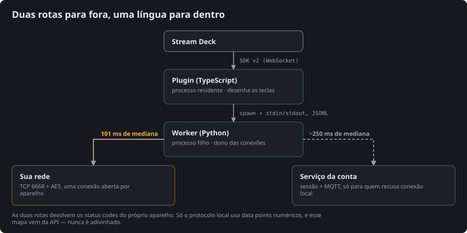

*Idioma: [English](TUYA.md) · **Português***

# O mundo Tuya / Smart Life, e onde este plugin se encaixa nele

Útil se você está decidindo se o plugin conversa com o seu hardware, ou se já se perguntou
por que toda ferramenta de casa inteligente desse ecossistema pede algo estranho.

## Uma plataforma, mil nomes de marca

Tuya não é uma marca que se compra — é a plataforma que as outras marcas compram. O
fabricante pega o módulo, o firmware e a nuvem da Tuya, imprime o próprio logotipo na
caixa e publica um aplicativo com a cara dele. A tomada, o interruptor de parede e o motor
de cortina podem ter três nomes diferentes e ser o mesmo aparelho por dentro.

Dois aplicativos genéricos comandam tudo isso: **Smart Life** e **Tuya Smart**. Mesmo
serviço, duas portas de entrada. Se o seu aparelho parear com qualquer um dos dois, este
plugin enxerga ele.

O aplicativo de marca do fabricante normalmente também funciona — a conta é a mesma — mas
os caminhos de menu do [PAIRING.pt-BR.md](PAIRING.pt-BR.md) estão escritos para os dois
aplicativos genéricos.

## Dois jeitos de um programa alcançar esses aparelhos

**A rota do desenvolvedor.** Cadastre-se na Tuya IoT Platform, crie um cloud project,
vincule a conta do aplicativo a ele e receba um Access ID e um Access Secret. Foi assim
que funcionou a geração anterior de integrações. Isso coloca uma conta de desenvolvedor,
um console de projeto e uma assinatura entre você e a sua própria lâmpada.

**A rota do QR.** A conta do seu aplicativo autoriza um programa específico numa máquina
específica, mostrando a ele um QR code. Sem conta de desenvolvedor, sem console, sem
projeto. É o que o Tua Casa faz, e é o fluxo que a integração Tuya do Home Assistant
estabeleceu — veja [Créditos](#créditos).

A rota do QR precisa de uma coisa que a do desenvolvedor não precisa: uma **identidade de
aplicativo**, um `client_id` e um `schema` registrados junto ao fabricante, que dizem
*qual programa* está pedindo. É daí que vem o único bloqueio registrado no
[LIMITS.pt-BR.md](../LIMITS.pt-BR.md) — leia antes de decidir o que fazer com este
projeto.

## O que a sessão compra

Aprovar o QR dá ao worker uma sessão na sua conta. Dela saem três coisas que nenhuma
quantidade de escuta de rede daria:

| | Por que importa |
|---|---|
| **Inventário de aparelhos** | ids, nomes, categorias, estado online, e se o aparelho aceita controle local |
| **Chaves locais** | a chave AES por aparelho que ele exige antes de aceitar um comando |
| **Mapa de capacidades** | quais status codes cada aparelho expõe, e como eles viram data points numéricos |

A **chave local** é a parte interessante. Um aparelho Tuya na sua rede não obedece a
desconhecido: ele quer uma chave que só a conta conhece. É por isso que uma ferramenta
puramente offline não pode existir aqui — alguém tem de buscar as chaves uma vez, e só a
conta as tem.

As chaves são renovadas pelo *Varrer a rede*, e refazer o pareamento de um aparelho no
aplicativo invalida a chave dele ([LIMITS.pt-BR.md](../LIMITS.pt-BR.md)).

## E então vai para a rede local

Com as chaves na mão, o worker deixa de precisar da internet para comandar.

Os aparelhos se anunciam na rede por broadcast UDP, e esse anúncio carrega o endereço e a
versão de protocolo que o aparelho fala
([`worker/tuacasa.py:158`](../streamdeck-plugin/com.felipedrummond.tuacasa.sdPlugin/worker/tuacasa.py#L158)).
O worker cruza isso com o inventário da conta
([`worker/tuacasa.py:474`](../streamdeck-plugin/com.felipedrummond.tuacasa.sdPlugin/worker/tuacasa.py#L474)):
a rede diz *onde*, a conta diz *o quê* e *com qual chave*. Os comandos então vão direto
por TCP 6668, cifrados em AES, numa conexão mantida aberta por aparelho.

Dois vocabulários se encontram aqui, e vale conhecer a diferença:

- **Status codes** — `switch_1`, `switch_led`, `percent_control`. Legíveis, estáveis, o
  que a API fala.
- **Data points (dps)** — `1`, `2`, `3`. O que o protocolo local fala, e cujo significado
  muda de produto para produto.

O Tua Casa fala status codes em todo lugar e converte para data points só na hora de
escrever no fio, usando o mapa `local_strategy` que a própria API entrega — nunca um
palpite
([`worker/tuacasa.py:10`](../streamdeck-plugin/com.felipedrummond.tuacasa.sdPlugin/worker/tuacasa.py#L10)).
Adivinhar esse mapeamento é a forma mais comum de uma ferramenta Tuya acabar ligando a
coisa errada.

## O que não vai funcionar, faça o que fizer

Alguns limites são da plataforma, não deste plugin:

- Aparelhos que **declaram não ter suporte local** — fechaduras, algumas centrais
  infravermelho. O fabricante proíbe no firmware.
- **Subdispositivos atrás de um gateway** (Zigbee, Bluetooth). Não têm endereço próprio;
  tudo chega neles pelo hub, pela conta.
- Aparelhos que **anunciam um endereço que não responde**. É problema de topologia de
  rede, em geral um nó mesh que reencaminha broadcast mas não unicast.

Os três caem na rota da conta quando o aparelho está online. A lista completa, com os
códigos de erro que os distinguem, está no [LIMITS.pt-BR.md](../LIMITS.pt-BR.md).

## Vizinhos que vale conhecer

Se o Tua Casa não é o que você precisa, estes resolvem problemas próximos e são todos
código aberto:

| Projeto | Para que serve |
|---|---|
| [tinytuya](https://github.com/jasonacox/tinytuya) | Biblioteca Python do protocolo local — a camada sobre a qual a rota local do Tua Casa é construída |
| [tuya-device-sharing-sdk](https://github.com/tuya/tuya-device-sharing-sdk) | O SDK do próprio fabricante para a sessão por QR, publicado pela Tuya |
| [Integração Tuya do Home Assistant](https://www.home-assistant.io/integrations/tuya/) | Automação da casa inteira, de onde vem o fluxo de QR usado aqui |

## Créditos

O fluxo de pareamento por QR é o que o projeto Home Assistant estabeleceu, e roda sobre o
SDK de compartilhamento de dispositivos da própria Tuya. Inventário completo de
dependências e licenças: [THIRD-PARTY.pt-BR.md](../THIRD-PARTY.pt-BR.md).

## Marcas

Tuya® e Smart Life® são marcas de seus respectivos donos. Este projeto **não é afiliado,
endossado nem patrocinado** por eles. Os nomes aparecem aqui apenas para dizer com quais
aparelhos o plugin conversa.
